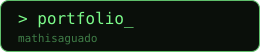

I'm a Master's student in Cloud and DevOps, working in an apprenticeship. I like automating things, building reliable systems, and shipping open-source tools. Daily driver: Linux (EndeavourOS + KDE Plasma).

